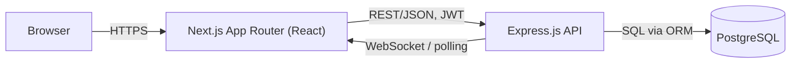

# ARCHITECTURE.md — Oi Tesla Ride-Pooling MVP

Stack: **Next.js (App Router)** · **Express.js** · **PostgreSQL**

---

## 1. System Overview



- **Frontend (Next.js):** passenger app (request ride, track status, history), driver app (go online, view/accept requests, manage active ride), shared auth pages.
- **Backend (Express.js):** REST API — auth, validation, business logic (matching, fare calc, state transitions, capacity enforcement), logging.
- **Database (PostgreSQL):** relational store. Rides/pools/seats/users have strict relational integrity and constraint needs (capacity, FK, unique-active-ride) that map naturally onto SQL constraints rather than app-only checks.
- **Real-time updates (MVP):** short-poll every 3–5s on ride/pool status. Documented upgrade path to WebSocket/SSE at scale (see PHASES.md bonus section).

No microservices, Kafka, Kubernetes, Redis, or queues in the MVP — added only if justified later (see the scaling reasoning in PHASES.md).

---

## 2. Stack Justification (README-ready)

| Choice | Alternatives considered | Why it fits this MVP | What would make me switch |
|---|---|---|---|
| Next.js (App Router) | Plain React + Vite | SSR/routing built-in; file-based routes map cleanly to passenger/driver/auth flows; easy free deploy (Vercel) | If SSR/SEO isn't needed and a leaner SPA is preferred |
| Express.js | NestJS, Fastify | Minimal ceremony for a small API surface (~15–20 endpoints); every line explainable in interview | If the API/team grows — NestJS's DI/module structure pays off |
| PostgreSQL | MongoDB, SQLite | CHECK/UNIQUE/FK constraints directly enforce capacity and lifecycle rules at the DB layer; transactions solve the seat-race problem cleanly | SQLite fine for local-only demos; would stay on Postgres at real scale |
| Prisma (proposed ORM) | TypeORM, raw SQL/knex | Type-safe queries, migration tooling, `$transaction` API maps directly onto the seat-claim race | Raw SQL if query complexity/perf tuning outgrows Prisma |
| JWT auth (proposed) | Session cookies + store | No extra infra (no Redis) needed for MVP; stateless | Session+store if refresh/revocation needs grow |
| Jest + Supertest (proposed) | Vitest, Mocha | Standard, integrates with Express + Prisma test DB | N/A at this scale |

---

## 3. Data Model (ERD)

```mermaid
erDiagram
    USERS ||--o{ RIDE_REQUESTS : "makes (as passenger)"
    USERS ||--o| TESLAS : "owns (as driver)"
    TESLAS ||--o{ POOLS : "serves"
    POOLS ||--o{ RIDE_REQUESTS : "contains"
    RIDE_REQUESTS ||--o| FARES : "has"
    RIDE_REQUESTS ||--o{ STATUS_HISTORY : "logs"
    POOLS ||--o{ STATUS_HISTORY : "logs"

    USERS {
        uuid id PK
        string name
        string email UK
        string password_hash
        enum role "passenger|driver"
        timestamp created_at
    }
    TESLAS {
        uuid id PK
        uuid driver_id FK
        string plate_or_name
        int capacity
        bool is_online
        timestamp created_at
    }
    POOLS {
        uuid id PK
        uuid tesla_id FK
        enum status "OPEN|FULL|IN_PROGRESS|COMPLETED|CANCELLED"
        int seats_taken
        string pickup_zone
        timestamp created_at
        timestamp updated_at
    }
    RIDE_REQUESTS {
        uuid id PK
        uuid passenger_id FK
        uuid pool_id FK "nullable until matched"
        string pickup_zone
        string destination_zone
        int seats_requested
        enum status "REQUESTED|MATCHED|DRIVER_ARRIVED|STARTED|COMPLETED|CANCELLED"
        timestamp requested_at
        timestamp updated_at
    }
    FARES {
        uuid id PK
        uuid ride_request_id FK UK
        int base_fare_paisa
        int distance_charge_paisa
        int pool_discount_paisa
        int total_fare_paisa
        enum payment_method "CASH|TESLAPAY"
        bool paid
    }
    STATUS_HISTORY {
        uuid id PK
        uuid ride_request_id FK "nullable"
        uuid pool_id FK "nullable"
        string from_status
        string to_status
        timestamp changed_at
        string note
    }
```

**DB-enforced constraints (not just app-level):**
- `TESLAS.capacity` CHECK > 0
- `POOLS.seats_taken <= tesla.capacity` — enforced transactionally (Section 5), not just a CHECK, since it depends on a join
- `RIDE_REQUESTS.status` is an enum, transitions validated by a single state-machine function
- Money stored as **integer paisa** (1 BDT = 100 paisa) — avoids float rounding error; UI divides by 100 only for display
- One `FARES` row per `RIDE_REQUESTS` (1:1 via UNIQUE FK)

---

## 4. Fare Model

```
passengerFare = baseFare + (distanceCharge * distanceKm) - poolDiscount
```

- `baseFare`: fixed, e.g. 30 BDT (3000 paisa)
- `distanceCharge`: per km, e.g. 15 BDT/km (1500 paisa/km)
- `poolDiscount`: flat 20% off, applied only when 2+ requests share a pool, computed per passenger on their own distance
- Distance is a **fixed lookup table** keyed by zone pair (no routing API)

**Hand-worked example:**
- Nusrat: Banani→Mohakhali, 4.5 km, pooled → `3000 + (1500×4.5) − 20% = 9750 − 1950 = 7800 paisa (78 BDT)`
- Rafiq: Banani→Gulshan 1, 3 km, pooled → `3000 + (1500×3) − 20% = 7500 − 1500 = 6000 paisa (60 BDT)`

**Matching rule:** two requests can share a pool if `pickup_zone` matches (or is one hop on a predefined adjacency list) **and** destination zones are on a compatible corridor **and** `seats_requested` combined fits remaining capacity.

---

## 5. Concurrency: The Seat Race

**Problem:** Bullet has 1 seat left. Nusrat and Shirin both request it near-simultaneously; both read `seats_taken = capacity − 1` before either writes.

**MVP solution:** wrap the seat claim in one transaction with row-level locking:

```sql
BEGIN;
SELECT seats_taken, capacity FROM pools JOIN teslas ...
  WHERE pool_id = $1 FOR UPDATE;
-- app checks seats_taken + requested < capacity
UPDATE pools SET seats_taken = seats_taken + $requested WHERE id = $1;
COMMIT;
```

`FOR UPDATE` blocks the second transaction until the first commits, so it re-reads the post-update value and correctly rejects/reroutes Shirin. Documented as sufficient for single-instance MVP scale; the scale-up path (optimistic versioning / reservation service) is covered in PHASES.md.

---

## 6. Ride/Pool Lifecycle

```
REQUESTED → MATCHED → DRIVER_ARRIVED → STARTED → COMPLETED
                 ↘ CANCELLED (from REQUESTED or MATCHED only)
```

- Only the driver transitions DRIVER_ARRIVED / STARTED / COMPLETED.
- Only the passenger (or system, on driver cancel) transitions to CANCELLED, and only before STARTED.
- Every transition writes a `STATUS_HISTORY` row — the append-only audit trail satisfying "hold onto enough history to explain what happened."
