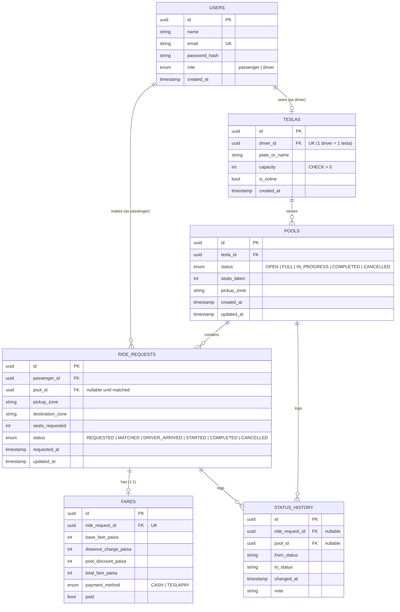

# Oi Tesla — Entity-Relationship Diagram (ERD)

This document visualizes the complete database schema and relational constraints.

For architectural decisions, refer to [ARCHITECTURE.md](../ARCHITECTURE.md#3-data-model-erd).

---

## Entity-Relationship Diagram

---

## Invariant Rules Enforced in Schema
1. **Integer Paisa Currency:** All monetary columns (`base_fare_paisa`, `distance_charge_paisa`, `pool_discount_paisa`, `total_fare_paisa`) are stored strictly as integers.
2. **Capacity Bounds:** `TESLAS.capacity > 0`. `POOLS.seats_taken <= TESLAS.capacity` guarded via transactional locking (`SELECT ... FOR UPDATE`).
3. **Audit Immutability:** `STATUS_HISTORY` records every state transition with timestamps and actor/system notes.
